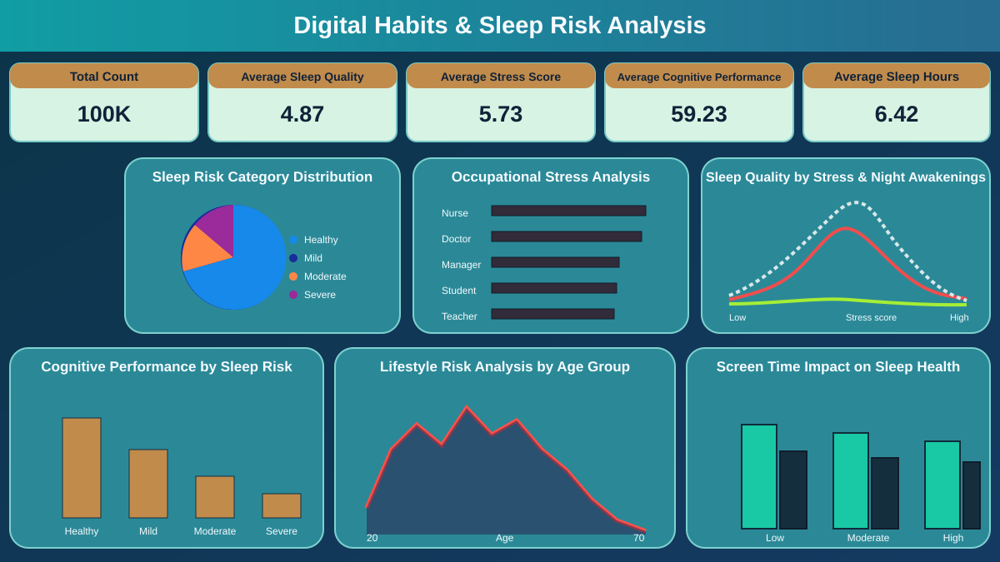

# Digital Habits & Sleep Risk Analysis

**Power BI | Data Analytics | Healthcare & Lifestyle Analytics**



## Project Overview

This end-to-end analytics project explores sleep patterns, lifestyle indicators, occupational stress, sleep-risk categories, and cognitive performance using a 100,000-record sleep-health dataset. It demonstrates data preparation, KPI development, business analysis, visualization, and dashboard design using Microsoft Power BI.

> **Interpretation note:** This project supports descriptive and exploratory analysis. Relationships observed in the dataset do not establish causation or provide medical diagnoses.

## Dashboard at a Glance

The supplied dashboard visual displays these headline metrics:

| KPI | Displayed value |
|---|---:|
| Total Count | 100K |
| Average Sleep Quality | 4.87 |
| Average Stress Score | 5.73 |
| Average Cognitive Performance | 59.23 |
| Average Sleep Hours | 6.42 |

Dashboard visuals:
1. Sleep Risk Category Distribution
2. Occupational Stress Analysis
3. Sleep Quality by Stress and Night Awakenings
4. Cognitive Performance by Sleep Disorder Risk
5. Lifestyle Risk Analysis by Age Group
6. Screen Time Impact on Sleep Health

Dashboard filters shown: Gender, Occupation, and Sleep Disorder Risk.

## Business Problem

Organizations and wellness teams may need a clearer understanding of how sleep patterns and lifestyle indicators vary across different groups. Stress, work schedules, bedtime screen exposure, caffeine and alcohol habits, and physical activity can be examined alongside sleep outcomes.

**Business question:** How can sleep-health and lifestyle data be analyzed to identify concerning patterns, understand group differences, and inform evidence-based wellness planning?

## Project Objectives

- Examine sleep duration and sleep quality.
- Compare sleep-related risk categories.
- Investigate stress patterns across occupations.
- Explore screen time and night-awakening patterns alongside sleep outcomes.
- Compare cognitive performance across risk categories.
- Build an interactive dashboard for filtering and exploration.
- Communicate findings and practical recommendations.

## Dataset

- **Dataset name:** Sleep Health and Daily Performance Dataset
- **Source:** [Kaggle dataset page](https://www.kaggle.com/datasets/mohankrishnathalla/sleep-health-and-daily-performance-dataset)
- **Analyzed file:** `sleep_health_dataset(2).csv` (provided for this project)
- **Reported size:** 100,000 rows and 32 columns
- **Domain:** Sleep health, lifestyle, and daily performance

Key fields include `person_id`, `age`, `gender`, `occupation`, `sleep_duration_hrs`, `sleep_quality_score`, `stress_score`, `screen_time_before_bed_mins`, `caffeine_mg_before_bed`, `alcohol_units_before_bed`, `steps_that_day`, `sleep_disorder_risk`, `cognitive_performance_score`, and `felt_rested`.

See [Dataset and Data Dictionary](Documentation/Dataset_and_Data_Dictionary.md).

## Business Questions

1. What is the average sleep duration?
2. What proportion of records falls into each sleep-risk category?
3. Which occupations have the highest average stress scores?
4. How does sleep quality vary across stress levels?
5. How does sleep duration vary by screen-time category?
6. How do caffeine and alcohol consumption patterns relate to sleep quality?
7. How does sleep duration vary across age groups?
8. How does cognitive performance vary by sleep-risk category?
9. How do steps and exercise patterns differ across risk categories?
10. Which groups have the highest proportion of people who do not feel rested?

See [Business Problem and Questions](Documentation/Business_Problem_and_Questions.md).

## KPIs

The supplied dashboard highlights:
- Total Count
- Average Sleep Quality
- Average Stress Score
- Average Cognitive Performance
- Average Sleep Hours

Additional recommended measures include high-risk percentage (Moderate + Severe), rested percentage, and category-level averages. Definitions and sample DAX are in [DAX/Measures.dax](DAX/Measures.dax).

## Tools & Methods

- Microsoft Power BI
- Power Query
- DAX (Data Analysis Expressions)
- CSV data source
- Data cleaning and validation
- KPI development
- Interactive slicers and cross-filtering
- Exploratory data visualization

## Visualizations

The dashboard includes six key analysis areas. Professional titles, field assignments, and interpretation notes are documented in [Chart Guide](Documentation/Chart_Guide.md).

## Key Findings from the Earlier File Analysis

The following descriptive results were calculated from the uploaded CSV in the project conversation and should be reconfirmed in the final PBIX before formal submission:

| Risk category | Records | Avg. sleep (hours) | Avg. quality | Avg. stress |
|---|---:|---:|---:|---:|
| Healthy | 54,156 | 6.93 | 5.77 | 5.04 |
| Mild | 33,479 | 6.05 | 4.17 | 6.32 |
| Moderate | 8,299 | 5.41 | 3.12 | 7.05 |
| Severe | 4,066 | 4.84 | 2.29 | 7.48 |

Other reported values: Healthy records 54.16%; Moderate + Severe records 12.37%; overall average sleep duration 6.42 hours.

These are dataset-specific descriptive statistics. Validate the category logic, measure aggregation, and filter context in the final Power BI report. More details: [Insights and Recommendations](Documentation/Insights_and_Recommendations.md).

## Recommendations

- Investigate groups with higher recorded risk or stress before targeting support.
- Explore bedtime screen-time, caffeine, and alcohol patterns alongside sleep outcomes.
- Review occupational and shift-work patterns to identify areas for further investigation.
- Consider educational wellness initiatives on sleep routines and stress management.
- Monitor sleep quality, duration, rested percentage, and risk-category distribution as future data becomes available.

## Repository Structure

```text
Digital-Habits-Sleep-Risk-Analysis/
├── README.md
├── Images/
│   └── Dashboard_Preview.jpg
├── Dashboard/
│   └── README.md
├── Dataset/
│   └── README.md
├── DAX/
│   └── Measures.dax
└── Documentation/
    ├── Business_Problem_and_Questions.md
    ├── Dataset_and_Data_Dictionary.md
    ├── Data_Cleaning.md
    ├── KPI_Guide.md
    ├── Chart_Guide.md
    └── Insights_and_Recommendations.md
```

The raw dataset and editable Power BI `.pbix` file are not included in this initial update because they were not supplied as repository-ready files. See the relevant folder notes for instructions.

## How to Use This Repository

1. Review the dashboard preview in [Images](Images/Dashboard_Preview.jpg).
2. Read the business problem and questions in [Documentation](Documentation/Business_Problem_and_Questions.md).
3. Review KPI definitions and example DAX in [DAX](DAX/Measures.dax).
4. Obtain the source dataset from Kaggle, subject to its license and terms.
5. Add your final Power BI `.pbix` file to the Dashboard folder when available.

## Author

**Abhishek A**  
GitHub: [@abhiarmugam16-tech](https://github.com/abhiarmugam16-tech)

---
*Project category: Data Analytics & Business Intelligence*
